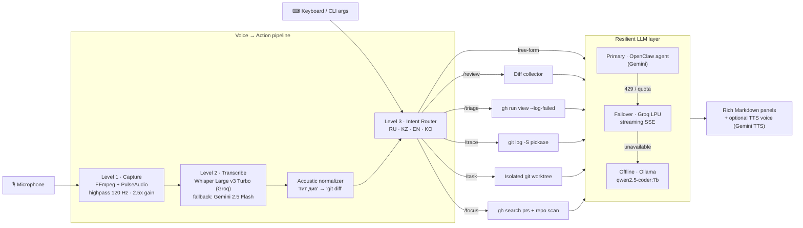

<div align="center">

# 🦾 J.A.R.V.I.S. — Voice-Driven Engineering Agent

**A voice-first, terminal-native AI copilot that turns spoken intent into real engineering workflows:<br/>pre-flight code review, CI failure triage, git archaeology and autonomous tasks in isolated worktrees.**

[](https://github.com/NURJAKS/jarvis-dev-agent/actions/workflows/ci.yml)


</div>

---

## Why this exists

Most AI coding tools live inside an IDE and wait for you to type. Real engineering time, however, is lost *between* the editor and everything around it: reading a diff before opening a PR, digging through a red CI log, finding out who introduced a function three months ago, or context-switching every morning to figure out what needs attention.

**J.A.R.V.I.S.** is a single-binary CLI agent that sits in the terminal, listens to you (in **Russian, Kazakh, English or Korean**), routes the request to a concrete engineering workflow, gathers the real context from `git` and the GitHub CLI, and only then asks an LLM to reason about it. The LLM never guesses — it always works on top of actual diffs, logs and history.

---

## ✨ Capabilities

| Command | Pillar | What actually happens |
| :--- | :--- | :--- |
| `jarvis review` | **Pre-flight Code Review** | Collects staged → unstaged → branch-vs-main diff, sends up to 30k chars to a Staff-level review prompt that checks N+1 queries, missing indexes, unsafe migrations, race conditions, blocking I/O in event loops and null-safety — then **generates a ready-to-paste PR description** (Summary / Breaking Changes / How to test). |
| `jarvis triage [run_id]` | **CI Incident Triage** | Finds the latest failed GitHub Actions run (or uses the given ID), pulls `--log-failed` via `gh`, and produces a root-cause hypothesis with a concrete fix. |
| `jarvis trace <symbol>` | **Git Archaeology** | Runs `git log -S` (pickaxe) + blame-style history on a symbol and explains *when*, *why* and *by whom* it changed. |
| `jarvis task "<prompt>"` | **Autonomous Background Agent** | Spawns a dedicated **`git worktree`** on a `jarvis/task-*` branch under `/tmp`, lets the agent edit, test and commit there — your working copy is never touched. |
| `jarvis focus` | **Daily Developer Digest** | Aggregates PRs awaiting your review, your own open PRs and every dirty repository under your dev root into a prioritized morning plan. |
| `jarvis ask "<q>"` | **Architecture Q&A** | Quick engineering / system-design answers grounded in your local knowledge base. |
| `jarvis` / `repl` | **Interactive Shell** | Claude-Code-style REPL with streaming output, persistent history, auto-suggest, session memory and push-to-talk voice input. |

---

## 🏗 Architecture



### ⚡ Dual-Engine Architecture: Standalone by Default

> **Works out of the box with just a Gemini/Groq key; optionally supercharged by OpenClaw for autonomous tool execution.**

J.A.R.V.I.S. operates on a pragmatic two-tier engine design:

1. **Standalone Mode (Zero Runtime Dependencies):**
   Anyone cloning this repo can immediately run `jarvis review`, `jarvis triage`, `jarvis trace`, `jarvis ask`, and the interactive `repl` with just a standard `GEMINI_API_KEY` (or `GROQ_API_KEY` / local `Ollama`). It speaks directly to the Gemini 2.5 Flash REST API without requiring any external agent runtime or daemon.
2. **Supercharged Mode (OpenClaw Engine):**
   If the optional OpenClaw runtime (`openclaw`) is detected on your system, J.A.R.V.I.S. activates its full autonomous tool loop: multi-file code editing in isolated `git worktree` sandboxes (`jarvis task`), persistent agent sessions, and the interactive curses TUI. If OpenClaw is absent, commands gracefully degrade to direct LLM turns instead of crashing.

### Design decisions worth calling out

- **Deterministic before generative.** Intent routing is pure regex over a normalized transcript — fast (sub-millisecond), testable and free. The LLM is only invoked once a workflow has collected real context. The router is covered by unit tests in [`tests/`](tests/).
- **Three-tier provider failover.** A quota detector (`429`, `RESOURCE_EXHAUSTED`, `rate_limit`) transparently drops from Gemini 2.5 Flash to **Groq LPU** (token-streamed over SSE) and finally to a **local Ollama** model — the assistant keeps working offline or on an exhausted API plan.
- **Physical isolation for autonomous edits.** `jarvis task` never writes to your checkout. Every run gets its own worktree and branch, so you review the result like a teammate's PR and merge or discard it.
- **Audio DSP at the edge.** A 120 Hz high-pass filter removes laptop fan rumble and a 2.5x gain stage lifts quiet speech *before* STT — measurably fewer misrecognitions of short commands.
- **STT-aware vocabulary.** An acoustic normalizer repairs the typical Whisper confusions for developer jargon (`гит див → git diff`, `кубер → kubernetes`, `ворктри → worktree`, `пулреквест → PR`).
- **Graceful degradation everywhere.** No microphone, no `gh`, no OpenClaw runtime, or no network — each workflow detects it and falls back cleanly instead of throwing unhandled exceptions.

---

## 🚀 Quick start

```bash
git clone https://github.com/NURJAKS/jarvis-dev-agent.git
cd jarvis-dev-agent
pip install -r requirements.txt
cp .env.example .env        # add your keys

# make it a global command
install -m 755 jarvis.py ~/.local/bin/jarvis
```

### Requirements

| Dependency | Needed for |
| :--- | :--- |
| Python 3.10+ | core CLI & all standard workflows |
| `GEMINI_API_KEY` | standalone LLM turns, pre-flight code review, STT fallback, TTS |
| `ffmpeg` + PulseAudio / PipeWire *(optional)* | push-to-talk voice capture |
| [`gh`](https://cli.github.com/) *(optional)* | GitHub Actions CI `triage` and morning `focus` digest |
| `GROQ_API_KEY` *(optional)* | Whisper Large v3 Turbo STT + fast LLM failover |
| [Ollama](https://ollama.com) *(optional)* | 100% offline local model fallback (`qwen2.5-coder:7b`) |
| OpenClaw runtime *(optional)* | supercharges autonomous worktree edits (`jarvis task`) and curses TUI |

### Usage

```bash
jarvis                         # interactive REPL (voice + text)
jarvis review                  # review current diff + generate PR description
jarvis triage                  # explain the latest failed GitHub Actions run
jarvis trace deductCredits     # who changed this symbol and why
jarvis task "add pagination tests for /users"   # autonomous, isolated worktree
jarvis focus                   # morning digest
jarvis ask "outbox vs CDC for event publishing?"
jarvis --voice review          # read the answer out loud
```

Voice examples the router understands:

> *"Сделай ревью"* · *"почему упал пайплайн"* · *"where is deductCredits"* · *"бүгінгі жоспар"* · *"запусти в фоне добавить тесты для auth"*

---

## ⚙️ Configuration

All machine-specific paths are environment-driven — see [`.env.example`](.env.example).

| Variable | Default | Purpose |
| :--- | :--- | :--- |
| `GEMINI_API_KEY` | — | Google Gemini (LLM, STT fallback, TTS) |
| `GROQ_API_KEY` | — | Groq Whisper + LLM failover |
| `JARVIS_KNOWLEDGE_BASE` | `~/Dev/Main-brain` | Local engineering knowledge base injected as context |
| `JARVIS_DEV_ROOT` | `~/Dev` | Root scanned by `focus` for dirty repositories |
| `JARVIS_OPENCLAW_BIN` | `openclaw` on `PATH` | Agent runtime binary |
| `JARVIS_NODE_BIN` | — | Extra Node.js `bin` dir prepended to `PATH` for the agent runtime |

---

## 🧪 Testing

```bash
pip install pytest
pytest -v
```

CI runs syntax linting and the test suite on every push via GitHub Actions.

---

## 🗺 Roadmap

- [ ] Wake-word activation ("Jarvis…") instead of push-to-talk
- [ ] Split the single-file CLI into a package (`audio/`, `intents/`, `providers/`, `workflows/`)
- [ ] Pluggable intent registry (YAML) instead of hard-coded patterns
- [ ] GitLab CI support for `triage`
- [ ] Post review comments directly to the PR via `gh pr review`

---

## 📄 License

[MIT](LICENSE) © Nurbek Abildaev
